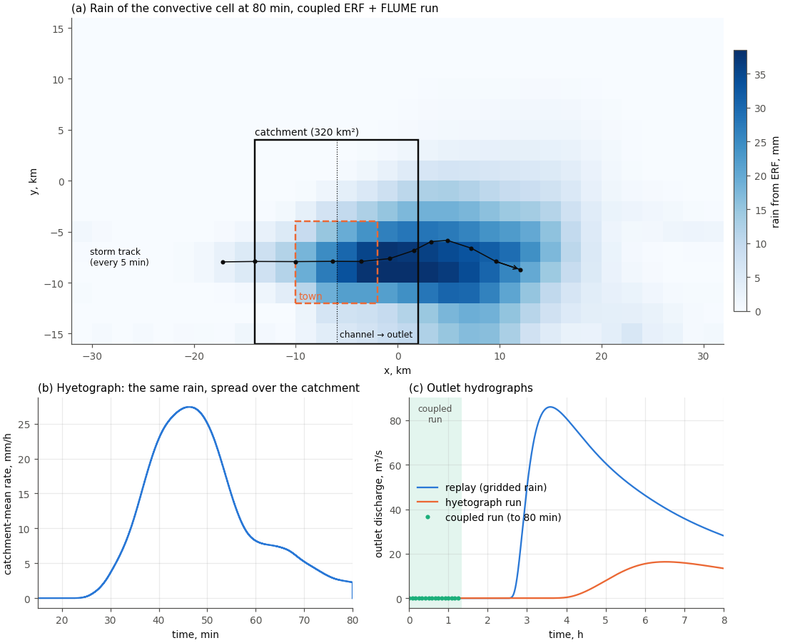

.. _sec:CoupledExample:

Coupled example: a storm over a catchment
=========================================

This example runs FLUME inside ERF (:ref:`sec:InsideERF`) with the rain of
ERF's microphysics. A convective cell passes over an urban catchment. The
same storm is then run three ways on the same flood grid:

- **coupled**: ERF and FLUME together, for the 80 min of the storm, with
  ``flume.rain.type = microphysics``;
- **replay**: FLUME alone, with the rain the coupled run wrote
  (:ref:`sec:RainReplay`), carried on to 8 h for the recession;
- **hyetograph**: FLUME alone, with the catchment-mean rate of the same rain
  at each step (``flume.rain.type = hyetograph``), to 8 h.

The case, its scripts and the numbers of one run are in ``Tests/ERFStorm``
(``README.md``). The CTest ``erf_flume_storm`` runs all three on 4 ranks.

         catchment-mean hyetograph, and the outlet hydrographs of the
         coupled run, the replay and the hyetograph run.
   :width: 100%

   (a) ERF's rain at the end of the coupled run (80 min), on ERF's columns
   of 2 km, with the catchment (black), the town (orange, dashed), the
   channel (dotted) and the track of the cell, the centre of each 5 min of
   rain. (b) The catchment-mean rate of the same rain. (c) The outlet
   discharge of the coupled run, its replay and the hyetograph run. The
   coupled run ends before the water reaches the outlet; the replay carries
   it on. Drawn by ``Tests/ERFStorm/plot_storm.py``.

The case
--------

**Atmosphere.** 64 x 32 x 16 km in 32 x 16 x 32 cells (2 km by 500 m),
periodic in x and open in y, in four boxes for four ranks. ERF's boundary-layer
problem starts from an input sounding: the thermodynamic profile of Weisman
and Klemp (1982) with water vapour capped at 16 g/kg (ERF's supercell case
caps it at 14 g/kg), and a westerly wind
:math:`u = 6 + 8 \tanh(z / 3\,\mathrm{km})` m/s. A warm bubble of 3 K at
x = -30 km, y = -8 km starts a cell. Kessler microphysics makes its rain.
ERF's step is fixed at 5 s, 960 steps.

**Flood grid.** ERF's columns refined by 8 (``erf.flood.grid_ratio = 8``):
256 x 128 cells of 250 m over the whole domain. ``flume.max_dt = 5`` makes
each ERF step one FLUME step, so the replay gives the coupled flood to
round-off.

**Catchment.** ``prepare_catchment.py`` writes the bed, the curve number and
the Manning n as ESRI ASCII grids. The bed is four valleys 16 km apart with
a 1 % cross slope, a divide at y = 4 km and a fall of 1.5 % to the ylo and
yhi sides; a channel 2 m deep and 500 m wide runs down each valley axis. The
catchment is the part of the valley at x = -6 km south of the divide: 16 x 20 km, 320
km\ :sup:`2`, leaving through the outflow segment ``outlet``. A town of 8 x
8 km under the storm's track has curve number 98 and n = 0.015; the rest of
the ground has 90 and 0.04, the channels n = 0.03.

**Hyetograph.** ``make_hyetograph.py`` reads the index of the coupled rain
and writes, for each line, its time and the mean rate over the catchment's
cells. The hyetograph rains on the whole domain at that rate, so the
catchment gets the coupled rain, at the same steps, spread evenly over it.

Results
-------

The cell rains on the catchment from about 20 to 80 min and moves east at
about 9 m/s along y = -6 to -9 km, over the town and the channel. The
catchment gets 10.9 mm on average, at most 27.4 mm/h (catchment mean), and
38 mm in the wettest column.

.. list-table:: Outlet discharge (8 h runs, 4 ranks)
   :header-rows: 1
   :widths: 30 20 20 30

   * - Run
     - Peak, m\ :sup:`3`/s
     - Time of peak
     - Out at ``outlet`` by 8 h, m\ :sup:`3`
   * - **Replay (gridded rain)**
     - **86.0**
     - **3.59 h**
     - **1.02e6**
   * - Hyetograph
     - 16.4
     - 6.52 h
     - 1.68e5

The replay's peak is 5.3 times the hyetograph run's and 2.9 h earlier. The
two runs put the same rain on the catchment, 3.49 \ :math:`\times`
10\ :sup:`6` m\ :sup:`3`; the difference is where it falls.

- **The curve-number loss is not linear in the rain.** The initial
  abstraction, 0.2 S, is about 5.6 mm at curve number 90 and 1.0 mm at 98.
  The hyetograph puts 10.9 mm on every cell, so each yields little. The
  cell leaves 45 % of the catchment below its abstraction and puts up to
  38 mm on the rest. On the rain grids the curve-number formula gives
  5.0 mm of runoff for the cell's rain and 1.9 mm for the hyetograph. With
  curve number 90 everywhere the ratio is 3.5, so this is most of the
  difference.
- **The town** takes 42 % of the catchment's rain on 20 % of its area.
- **Routing.** The hyetograph's runoff is a thin sheet over the whole
  catchment, and Manning's speed falls with depth. By 8 h the outlet passes
  63 % of the replay's runoff and 27 % of the hyetograph's.

The outlet passes 29 % of the catchment's rain in the replay and 4.8 % in
the hyetograph run. FLUME's curve-number loss uses each cell's own
cumulative rain: water that runs on from the town to rural ground is not
infiltrated.

The case runs FLUME at first order (``flume.order = 1``, the default). The
bed falls 2.5 to 3.75 m per cell against depths of millimetres to 0.2 m. At
such a ratio the first-order bed source holds cell depths above Manning's
normal depth and cell velocities below it (a 1D channel of the same slope
and roughness: 0.081 m against 0.062 m on 250 m cells). The face fluxes
carry the water, so the water balance and the outlet hydrographs are not
affected; depths, gauge velocities and storage are of this scheme and
grid.

ERF's fixed step of 5 s is below its CFL limit at the start (about 6.7 s).
In the cell's updraft ERF warns of a Courant number of 0.88, above its
``erf.cfl`` of 0.8; the run stays stable.

These numbers are of one build. Convection is chaotic: another compiler or
processor rounds differently and moves the cell. The test therefore checks
the coupling to round-off (the rain on the catchment, the replay, the
hyetograph's rain) and the hydrographs loosely (a peak ratio of at least 3,
a lead of at least 1 h).

Running it
----------

From the build directory of a ``-DFLUME_WITH_ERF=ON -DFLUME_MPI=ON`` build:

.. code-block:: bash

   ctest -R erf_flume_storm --output-on-failure
   python3 <repo>/Tests/ERFStorm/plot_storm.py Tests/run/erf_flume_storm erf_storm.png

The coupled run takes about 25 s on 4 ranks and each stand-alone run about
5 s. The steps by hand are in ``Tests/ERFStorm/README.md``.

The coupled run writes about 190 MB of rain grids (856 lines of 256 x 128
cells, ESRI ASCII text). A longer storm or a finer flood grid writes more in
proportion; see :ref:`sec:CouplingLimits`.

The sounding follows M. L. Weisman and J. B. Klemp (1982), *Monthly Weather
Review* 110, 504-520, with the constants of ERF's supercell case; thanks to
the ERF developers.
