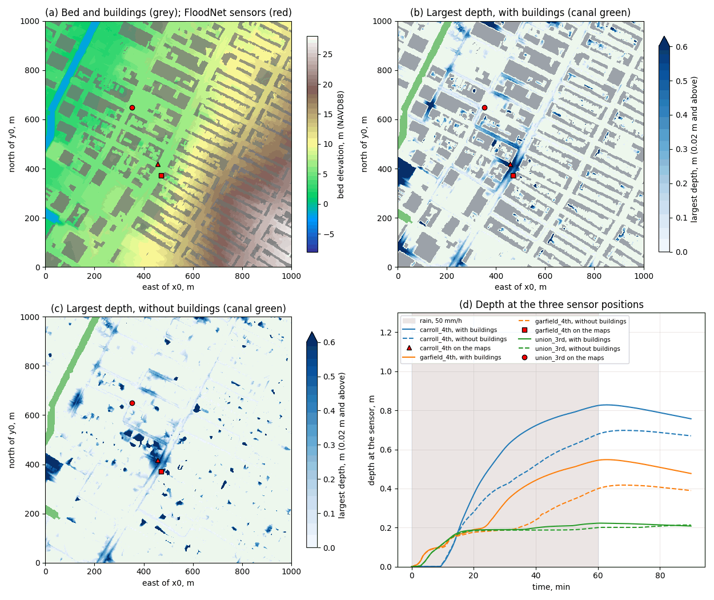

.. _sec:GowanusExample:

Gowanus example: rain on real streets and buildings
===================================================

This example runs FLUME alone on a real place: a square of 1 km in Gowanus,
Brooklyn, New York, on 500 x 500 cells of 2 m. The bed is lidar terrain of
the U.S. Geological Survey's 3D Elevation Program and the buildings are the
footprints and roof heights of New York City's open Building Footprints
(``flume.bed.file``, ``flume.buildings.file``). Three gauges stand at the
positions of FloodNet street-flood sensors.

It is a demonstration of how the pieces work together, not a hindcast:

- the rain is one rate over the square, 50 mm/h for one hour, then 30 min
  with none (``flume.rain.type = hyetograph``);
- there are no sewers and no infiltration;
- every side is a wall, so the square keeps its rain.

The same rain is run with the buildings and on the bare terrain.

         without the buildings, and the depth at three sensor positions.
   :width: 100%

   Panel (a): the bed and the buildings, with the three FloodNet sensor
   positions. Panel (b): the largest depth of the run with the buildings.
   Panel (c): the same without them. Panel (d): the depth at the sensor
   positions. The canal is green in panels (b) and (c). Drawn by
   ``Tests/Gowanus/plot_gowanus.py``.

What it shows
-------------

- The water collects on 4th Avenue between Garfield Place and Carroll
  Street, with and without the buildings: the terrain picks the place.
- The buildings move the water onto the streets. Over the whole square the
  flooded area is about the same in the two runs; off the building
  footprints it is 1.5 to 2.4 times larger with the buildings, and the peak
  depth at Carroll Street is 0.83 m against 0.70 m.
- Of the 0.83 m, 0.48 m lies below the level at which the hollow spills
  over the surface. The rest is water on its way out and depends on the
  rain rate chosen.
- Both runs close their water balance to round-off.

The depths at single points change by up to 0.1 m between cells of 2 m and
4 m, while the level of the pool changes by 0.5 cm. The case is not a
validation against the sensors.

The case, its scripts, the data sources and their acknowledgements, and
the numbers of one run are in ``Tests/Gowanus`` (``README.md``). The terrain
and the footprints are downloaded by ``prepare_gowanus.py --download``;
neither is in the repository, so the case has no CTest.

The choice of the place follows Annis, Badas and Mascaro (2026), who model
two Brooklyn basins against FloodNet sensors and measured storms, with and
without the effect of the sewer (:doc:`References`).

Thanks to the U.S. Geological Survey for the 3DEP elevation, to the City of
New York for the open building footprints, and to the FloodNet team and the
New York City Department of Environmental Protection for their open
street-flood measurements.
