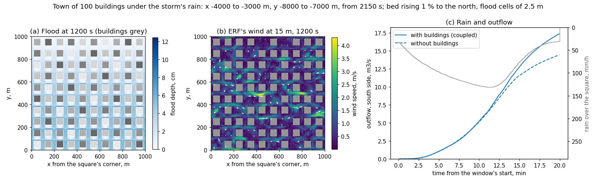

.. _sec:TownExample:

Town example: the storm's rain over buildings
=============================================

This example floods a town of buildings with the rain of the coupled storm
(:ref:`sec:CoupledExample`). It is a chain of two runs:

1. **The storm.** ERF with FLUME on 250 m cells writes its rain as grids
   (:ref:`sec:RainReplay`).
2. **The town.** ERF on 10 m cells resolves the wind around 100 buildings
   with its immersed forcing (``erf.buildings_type = ImmersedForcing``).
   FLUME, inside ERF, floods the same town on 2.5 m cells
   (``flume.buildings.file``) with the storm's rain over it
   (``flume.rain.type = gridded``).

The coupling is one way, through the rain files: the town does not change
the storm. The same town is run twice more with FLUME alone on the same
flood grid, with the buildings (the coupled flood again, to the bit) and
without them.

The case, its scripts and the numbers of one run are in
``Tests/ERFStormTown`` (``README.md``). The CTest ``erf_flume_town`` runs
the three on 4 ranks, after ``erf_flume_storm``.

         buildings, and the rain and outflow of the runs with and without
         buildings.
   :width: 100%

   (a) The flood depth at the end of the 20 min window, with the buildings
   in grey. (b) ERF's wind at 15 m at the same time, with the solid cells in
   grey. (c) The rain over the square (grey, right axis, downward) and the
   outflow through the south side with and without the buildings, a mean
   over 10 s. Drawn by ``Tests/ERFStormTown/plot_town.py``.

The case
--------

**Square and window.** ``prepare_town.py`` reads the storm's index of rain
and picks, inside the storm case's town (x from -10 to -2 km, y from -12 to
-4 km), the square of 1 km on the storm's 250 m lines and the 1200 s,
starting at an entry of the index, with the most rain. It writes the index
of that window with its times from 0. The storm's grids are used as written:
FLUME maps each grid to its cells by the mean over each cell, so the square
gets the rain of the 16 storm cells it covers. The pick is made from the
rain itself, so the case holds where the storm's cell moves on another
compiler or processor. In the CTest run the square is x from -4000 to
-3000 m, y from -8000 to -7000 m, from 2150 s, with 28.85 mm of rain.

**Buildings.** 10 x 10 blocks of 100 m, each with a building of 60 x 60 m in
its middle and streets of 40 m between them. The heights are 10 to 40 m in
steps of 5 m. ``prepare_town.py`` writes the same buildings twice: ERF's
heights on its nodes of 10 m (``erf.buildings_file_name``) and FLUME's on its
cells of 2.5 m (``flume.buildings.file``). FLUME does not read ERF's
buildings (:ref:`sec:CouplingLimits`).

**Atmosphere.** 1 x 1 x 0.24 km in 100 x 100 x 24 cells of 10 m, periodic in
x, slip walls in y and at the top, a surface layer at the ground, a neutral
sounding with a westerly wind of 5 m/s. ERF's compressible step counts the
speed of sound in its CFL check, which held the fixed step at 0.034 s on
10 m cells, so the case is anelastic
(``erf.compressibility_type = Anelastic``) with ``erf.fixed_dt = 0.75`` s,
1600 steps. At 1.0 s ERF warned of a Courant number of 0.88 in the street
jets.

**Flood.** ERF's columns refined by 4: 400 x 400 cells of 2.5 m. The bed is
a plane rising 1 % to the north, Manning n = 0.015, an outflow segment on
the south side. ``flume.max_dt = 0.25`` makes three FLUME steps in each ERF
step, so the stand-alone run with the same steps gives the coupled flood to
the bit.

Results
-------

.. list-table:: Outflow through the south side (1200 s, 4 ranks)
   :header-rows: 1
   :widths: 30 20 20 30

   * - Run
     - Out, m\ :sup:`3`
     - Peak, m\ :sup:`3`/s
     - Largest depth in the streets
   * - **With buildings**
     - **8212**
     - **17.4**
     - **0.125 m**
   * - Without buildings
     - 7407
     - 14.5
     - 0.031 m

Both runs get 28847 m\ :sup:`3` of rain, and both peaks are at the end of
the window, while the water is still rising. With the buildings, the roofs
(36 % of the square) shed their rain into the streets, where the water is
deeper and, by Manning's law, faster: 28 % of the rain has left by 1200 s,
against 26 % on the bare bed. The water runs south, down the bed; the
deepest is against the north walls of the southern row of buildings.

The test checks that the coupled rain is the storm's rain over the square
at every step, that ERF's solid columns are FLUME's building columns with
heights within 0.0035 m, that the air inside ERF's buildings is at rest,
that FLUME alone gives the coupled flood to the bit, and that the water
balances close. It does not test ERF's drag coefficient: ERF holds the faces
inside a building at rest after its projection, and the faces at a wall
take the wall law (``erf.if_use_most``).

The water balances are checked with the factor 1024 in place of 64
(``erf_flume_add_regtest(... BALANCE_FACTOR 1024)``): each storm cell
covers 100 x 100 flood cells with the same rain, so the roundings of FLUME's
sums of equal values add up in one direction. The factor is about twice the
largest ratio measured, not a bound; ``Tests/ERFStormTown/README.md`` gives
the ratios.

Running it
----------

From the build directory of a ``-DFLUME_WITH_ERF=ON -DFLUME_MPI=ON`` build:

.. code-block:: bash

   ctest -R "erf_flume_storm|erf_flume_town" --output-on-failure
   python3 <repo>/Tests/ERFStormTown/plot_town.py Tests/run/erf_flume_town \
       Tests/run/erf_flume_town_setup erf_town.png

The coupled run takes about 2.5 min on 4 ranks, most of it in ERF, and each
stand-alone run about 10 s. The steps by hand are in
``Tests/ERFStormTown/README.md``.

The rain comes from the storm case, whose sounding follows M. L. Weisman and
J. B. Klemp (1982), *Monthly Weather Review* 110, 504-520, with the constants
of ERF's supercell case. The wind around the buildings uses ERF's immersed
forcing for buildings; thanks to the ERF developers.
