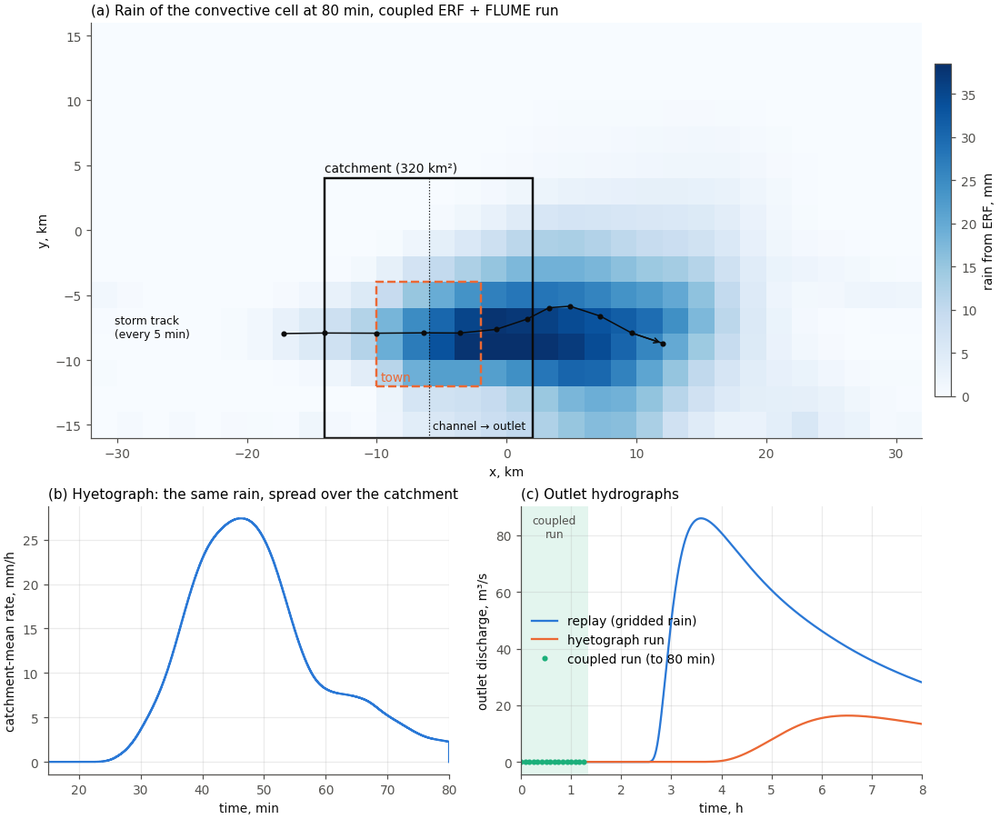

# A convective cell over an urban catchment

## Purpose

The coupled example of FLUME inside ERF: a convective cell made by ERF's
Kessler microphysics passes over an urban catchment, and FLUME takes its
rain (`flume.rain.type = microphysics`). The same storm is then run three
ways on the same flood grid:

- **coupled**: ERF and FLUME together, for the 80 min of the storm;
- **replay**: FLUME alone, with the rain the coupled run wrote
  (`flume.rain.replay_file`, then `flume.rain.type = gridded`), carried on
  to 8 h for the recession;
- **hyetograph**: FLUME alone, with the catchment-mean rate of the same
  rain at each step (`flume.rain.type = hyetograph`), to 8 h.

The replay gives the coupled flood to round-off. The hyetograph puts the
same rain on the catchment at the same steps, spread evenly over it. Its
outlet peak is lower and later than the replay's, for three reasons:

- **The curve-number loss is not linear in the rain.** The initial
  abstraction, 0.2 S, is about 5.6 mm at curve number 90 and 1.0 mm at 98.
  The hyetograph puts 10.9 mm on every cell, just above 5.6 mm, so each
  cell yields little. The cell leaves 45 % of the catchment below its
  abstraction and puts up to 38 mm on the rest. The curve-number formula on
  the rain grids gives 5.0 mm of runoff for the cell's rain and 1.9 mm for
  the hyetograph. With curve number 90 everywhere the ratio is 3.5, so this
  is most of the difference.
- **The town.** It takes 42 % of the catchment's rain on 20 % of its area.
- **Routing.** The hyetograph's runoff is a thin sheet over the whole
  catchment, and Manning's speed falls with depth (as h^(2/3)). By 8 h the
  outlet passes 63 % of the replay's runoff and 27 % of the hyetograph's.

The outlet passes 29 % of the catchment's rain in the replay and 4.8 % in
the hyetograph run. FLUME's curve-number loss uses each cell's own
cumulative rain: water that runs on from the town to rural ground is not
infiltrated.



The figure: (a) ERF's rain at the end of the coupled run, with the
catchment, the town, the channel and the cell's track; (b) the hyetograph;
(c) the outlet discharge of the three runs. The coupled run ends before the
water reaches the outlet; the replay carries it on.

The description is in `Docs/sphinx_doc/CoupledExample.rst`.

## Files

| File | What it is |
| --- | --- |
| `inputs_storm` | ERF's deck: 64 x 32 x 16 km in 32 x 16 x 32 cells (2 km by 500 m), periodic in x, open in y, four boxes for four ranks; Kessler microphysics; a warm bubble of 3 K at x = -30 km, y = -8 km; `erf.fixed_dt = 5` s, 960 steps (80 min); the flood grid ERF's columns refined by 8 (256 x 128 cells of 250 m); `flume.rain.replay_file = rain/storm.txt`. |
| `sounding_storm` | The sounding `inputs_storm` reads (`erf.input_sounding_file`), written by `make_sounding.py`. |
| `make_sounding.py` | Writes `sounding_storm`: the thermodynamic profile of Weisman and Klemp (1982), water vapour capped at 16 g/kg (this case's choice; ERF's supercell case caps it at 14 g/kg), and a westerly wind u = 6 + 8 tanh(z / 3 km) m/s. |
| `flume_catchment` | FLUME's half of the case (`FILE=`), read by the three runs: the rasters, curve-number infiltration, four outflow segments, two gauges, `flume.max_dt = 5` (one FLUME step per ERF step). |
| `prepare_catchment.py` | Writes `bed.asc`, `cn.asc` and `manning.asc` (256 x 128 cells of 250 m) into a directory: four valleys 16 km apart with a 1 % cross slope, a divide at y = 4 km, a fall of 1.5 % to the ylo and yhi sides, a channel 2 m deep and 500 m wide down each axis; curve number 98 and n = 0.015 in the town (x from -10 to -2 km, y from -12 to -4 km), 90 and 0.04 elsewhere, n = 0.03 in the channels. The catchment is x from -14 to 2 km, y from -16 to 4 km (320 km2). |
| `inputs_standalone` | The stand-alone runs on the flood grid ERF sets: 256 x 128 cells, periodic in x, boxes of 64, 8 h, a plotfile every 480 steps. |
| `make_hyetograph.py` | Writes the catchment-mean hyetograph of an index of gridded rain. |
| `check_storm.py` | The checks below, in the directory of the coupled run. It runs the replay in `replay/` and the hyetograph run in `hyeto/`. |
| `plot_storm.py` | Draws the figure from the directory of the CTest run (needs matplotlib and numpy; not run by CTest). |
| `ERFStormTests.cmake` | The CTest definitions, included from `Tests/CMakeLists.txt` with `FLUME_WITH_ERF=ON`. |

`check_storm.py` reads the plotfiles with `Tests/check_plotfile.py`, the
water balance with `Tests/check_balance.py`, and uses the replay checks of
`Tests/ERFReplay/check_replay.py`.

## Data and acknowledgements

No external data are used or redistributed, and nothing needs to be
downloaded. The catchment is synthetic. The sounding follows the analytic
profile of

- M. L. Weisman and J. B. Klemp, 1982: The dependence of numerically
  simulated convective storms on vertical wind shear and buoyancy. *Monthly
  Weather Review*, 110, 504-520,
  doi:10.1175/1520-0493(1982)110<0504:TDONSC>2.0.CO;2,

with the constants of ERF's supercell case
(`Submodules/ERF/Source/Prob/ERF_InitCustomPert_SuperCell.H` and
`Exec/CanonicalTests/SuperCell_3D`, ERF repository, BSD-3-Clause-LBNL
licence). The atmosphere uses ERF's boundary-layer problem with an
input sounding and a warm bubble. Thanks to the ERF developers.

## How to run

From the build directory of a `-DFLUME_WITH_ERF=ON -DFLUME_MPI=ON` build:

```bash
ctest -R erf_flume_storm --output-on-failure
```

By hand, from an empty directory:

```bash
python3 <repo>/Tests/ERFStorm/prepare_catchment.py catchment
cp <repo>/Tests/ERFStorm/sounding_storm .
mpiexec -n 4 <build>/ERF/Exec/erf_exec <repo>/Tests/ERFStorm/inputs_storm \
    FILE=<repo>/Tests/ERFStorm/flume_catchment
python3 <repo>/Tests/ERFStorm/make_hyetograph.py rain/storm.txt hyetograph.txt
mkdir replay hyeto && ln -s ../catchment replay/ && ln -s ../catchment hyeto/
cd replay && mpiexec -n 4 <build>/flume <repo>/Tests/ERFStorm/inputs_standalone \
    FILE=<repo>/Tests/ERFStorm/flume_catchment flume.rain.type=gridded \
    flume.rain.file=../rain/storm.txt && cd ..
cd hyeto && mpiexec -n 4 <build>/flume <repo>/Tests/ERFStorm/inputs_standalone \
    FILE=<repo>/Tests/ERFStorm/flume_catchment flume.rain.type=hyetograph \
    flume.rain.file=../hyetograph.txt && cd ..
python3 <repo>/Tests/ERFStorm/plot_storm.py . erf_storm.png
```

On 4 ranks of a laptop the coupled run takes about 25 s and each
stand-alone run about 5 s. The coupled run writes about 190 MB of rain grids
(856 lines, 854 grids of 256 x 128 cells); the CTest directory holds about
300 MB.

## Expected Results

From the CTest run (Apple clang, macOS arm64, Release, 4 ranks):

| Check | Result |
| --- | --- |
| Coupled run | Its water balance closes (`Tests/check_balance.py`, factor 64): largest ratio 11.7. |
| Rain on the catchment | ERF's `precip_total_accum` over the catchment's 8 x 10 columns equals the hyetograph's rain at each of the 17 plt2d plotfiles: 3485670.68 m3 (10.89 mm) at 80 min, largest difference 2.1e-9 m3 (bound 1e-12 of the total, 3.5e-6 m3). The peak catchment-mean rate is 27.4 mm/h at 46 min. |
| Index | 856 lines, 854 grids of rain, closed at 4800 s; their rain is that of the coupled water balance, 9101478.86 m3. |
| Replay | Every depth of flood00480 and flood00960 within 0.04 of 64 eps (h + R) of the coupled depth (R = 0.038 m); the same rain to the bit. |
| Hyetograph run | Its water balance closes: the largest change of the residual is 99 times eps (n (V + moved) + totals), below 256 times (see below). Its rain at each of its 5761 lines is the hyetograph's depth times the domain's area, to 2.6e-8 m3 of 2.2e7 m3. |
| Hydrographs | Replay: peak 86.0 m3/s at 3.59 h. Hyetograph run: peak 16.4 m3/s at 6.52 h. Ratio 5.3, lead 2.9 h. |

| Run (8 h) | Rain on the domain, m3 | Infiltrated, m3 | Out at `outlet`, m3 | Largest depth at gauge `town` |
| --- | --- | --- | --- | --- |
| Replay | 9.10e6 | 6.25e6 | 1.02e6 | 0.085 m at 1.72 h |
| Hyetograph | 2.23e7 | 2.03e7 | 1.68e5 | 0.037 m at 3.34 h |

The hyetograph run rains on the whole domain (FLUME's hyetograph has one
rate everywhere), so its domain totals are larger than the replay's; the
catchment gets the same 3.49e6 m3 in both.

The case runs FLUME at first order (`flume.order = 1`, the default). The
bed falls 3.75 m per cell along the channel and 2.5 m per cell across the
slopes, against depths of millimetres to 0.2 m. At such a ratio the
first-order bed source holds cell depths about 30 % above Manning's normal depth
and cell velocities well below it (a 1D channel of the same slope and
roughness: 0.081 m against 0.062 m at 250 m cells). The face fluxes carry
the water, so the water balance and the outlet hydrographs, which are
built from them, are not affected. Depths, gauge velocities and storage
are of this scheme and this grid.

The checks are bounded so that they hold on another compiler or processor
where the cell's rain differs. The rain, replay and hyetograph-rain checks
compare runs of this build with each other, to round-off. The hydrograph
check is loose (a peak ratio of at least 3, a lead of at least 1 h, both
peaks at least 1 h before the end), because convection is chaotic: a
different rounding moves the cell.

The water balance of the hyetograph run is checked with
`Tests/check_balance.py` with the factor 256 in place of 64. The hyetograph
wets every cell at once and, from about 18 to 36 min, all of its rain
infiltrates. FLUME sums the rain of each step over the 8192 cells of a rank,
and the infiltration from each cell's cumulative depth. The hyetograph makes
these values equal in every cell, so the roundings of each sum add up in one
direction rather than at random: a sum of 8192 equal values errs by up to
about 1000 eps, against about 11 eps for random values. The bound of
`check_balance.py` does not hold this. The largest ratio measured is 99; the
residual stays within 5.2e-7 m3 and does not drift after the rain ends.

Each check fails against one change:

| Change | Check that fails |
| --- | --- |
| `make_hyetograph.py` averages the whole domain | Rain on the catchment (at 600 s: 0 against 0.0043 m3) |
| `make_hyetograph.py` takes the catchment one cell (250 m) east | Rain on the catchment (at 1200 s) |
| `make_hyetograph.py` writes each time one step (5 s) late | Rain on the catchment (at 1200 s) |
| The hyetograph run with `flume.rain.interpolation = linear` | Hyetograph rain (at 1070 s; the totals agree, since the rate is 0 at both ends) |
| `check_storm.py` swaps the replay and the hyetograph run | Hydrographs |
| `BALANCE_FACTOR = 64` | Hyetograph balance (step 225) |

## CTest

`erf_flume_storm_catchment` (the rasters, a fixture) and `erf_flume_storm`
(4 ranks). See `Docs/sphinx_doc/TestCatalog.rst`.
