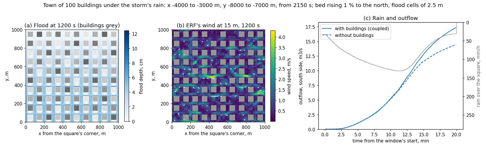

# The storm's rain over a town of buildings

## Purpose

A building-resolving flood under the rain of the coupled storm case
(`Tests/ERFStorm`). The case is a chain of two runs:

1. **The storm.** `erf_flume_storm` runs ERF with FLUME on 250 m cells for
   80 min and writes its rain as grids (`rain/storm.txt`).
2. **The town.** ERF on 10 m cells resolves the wind around 100 buildings
   with its immersed forcing (`erf.buildings_type = ImmersedForcing`).
   FLUME, inside ERF, floods the same town on 2.5 m cells
   (`flume.buildings.file`) with the storm's rain over it
   (`flume.rain.type = gridded`).

The coupling is one way, through the rain files: the town does not change
the storm. `prepare_town.py` picks the square of 1 km and the 20 min of most
rain inside the storm case's town, from the rain itself.

The same town is then run twice more with FLUME alone on the same flood
grid:

- **with the buildings**: the coupled flood again, to the bit;
- **without the buildings**: the same rain on the bare bed, to show what
  the buildings change.



The figure: (a) the flood depth at the end of the window, with the
buildings in grey; (b) ERF's wind at 15 m, with the solid cells in grey;
(c) the rain over the square (grey, the right axis, downward) and the
outflow through the south side with and without the buildings (a mean over
10 s).

The description is in `Docs/sphinx_doc/TownExample.rst`.

## Files

| File | What it is |
| --- | --- |
| `prepare_town.py` | Reads the storm's index of rain and writes the town into a directory: `rain.txt` (the window's index, times from 0, the storm's grids), `buildings_erf.txt` (ERF's building heights on its nodes of 10 m), `buildings.asc` (FLUME's on its cells of 2.5 m), `town.inputs` (the square for ERF and FLUME, and the file names), `town_flume.inputs` and `town_flume_open.inputs` (the stand-alone runs with and without the buildings), `window.txt` (the square, the window and its rain). |
| `inputs_town` | ERF's deck: the square, 1 x 1 x 0.24 km in 100 x 100 x 24 cells of 10 m, periodic in x, slip walls in y and at the top, a surface layer at the ground; anelastic; four boxes for four ranks; `erf.fixed_dt = 0.75` s, 1600 steps (1200 s); the flood grid ERF's columns refined by 4 (400 x 400 cells of 2.5 m). |
| `sounding_town` | A neutral sounding: 300 K, a westerly wind of 5 m/s (`erf.input_sounding_file`). |
| `flume_town` | FLUME's half of the case (`FILE=`), read by the three runs: `flume.max_dt = 0.25` (three FLUME steps in each ERF step), gridded rain, a plane bed rising 1 % to the north, Manning n = 0.015, an outflow segment on the south side. |
| `inputs_standalone` | The stand-alone runs on the flood grid ERF sets: 400 x 400 cells, periodic in x, boxes of 200, 1200 s. |
| `check_town.py` | The checks below, in the directory of the coupled run. It runs the stand-alone runs in `standalone/` and `no_buildings/`. |
| `plot_town.py` | Draws the figure from the directory of the CTest run (needs matplotlib and numpy; not run by CTest). |
| `ERFStormTownTests.cmake` | The CTest definitions, included from `Tests/CMakeLists.txt` with `FLUME_WITH_ERF=ON`. |

`check_town.py` reads the plotfiles itself, the water balance with
`Tests/check_balance.py`, and runs the stand-alone commands with
`Tests/ERFReplay/check_replay.py`.

### The town

- **Square.** 1 km on the storm's 250 m lines, inside the storm case's town
  (x from -10 to -2 km, y from -12 to -4 km). The window is 1200 s and starts
  at an entry of the index. `prepare_town.py` takes the square and window
  with the most rain. In the CTest run this is x from -4000 to -3000 m,
  y from -8000 to -7000 m, from 2150 s: 28.85 mm (28847 m3).
- **Buildings.** 10 x 10 blocks of 100 m. Each holds a building of 60 x 60 m
  in its middle, so the streets are 40 m wide. The heights are 10 to 40 m in
  steps of 5 m, 10 + 5 ((3 i + 5 j) mod 7) for block (i, j). ERF's nodes
  inside or on a footprint get its height. FLUME's cells whose centre is
  inside a footprint get its height: 24 x 24 cells of 2.5 m, the 6 x 6 ERF
  columns that the footprint fills.
- **Rain.** The storm's grids are used as written (256 x 128 cells of 250 m
  over the storm's domain). FLUME maps each grid to its cells by the mean
  over each cell, so the square gets the rain of the 16 storm cells it
  covers. The rate is held from one entry to the next
  (`flume.rain.interpolation = step`, FLUME's default).

### Why anelastic, and why 0.75 s

ERF's compressible step checks the CFL condition with the speed of sound
included, which held the fixed step at 0.034 s on 10 m cells. The anelastic
equations (`erf.compressibility_type = Anelastic`) leave sound out. At
`erf.fixed_dt = 1.0` ERF warned of a Courant number of 0.88 in the street
jets, above its `erf.cfl` of 0.8; at 0.75 s it does not warn. FLUME's own
CFL step is about 0.46 s; `flume.max_dt = 0.25` makes three FLUME steps in
each ERF step, in the coupled and the stand-alone runs alike.

## Data and acknowledgements

No external data are used or redistributed, and nothing needs to be
downloaded. The rain is that of the storm case, written by its CTest run
(`Tests/ERFStorm`, whose sounding follows Weisman and Klemp, 1982, with the
constants of ERF's supercell case). The town is synthetic. The wind around
the buildings uses ERF's immersed forcing for buildings (ERF repository,
BSD-3-Clause-LBNL licence). Thanks to the ERF developers.

## How to run

From the build directory of a `-DFLUME_WITH_ERF=ON -DFLUME_MPI=ON` build:

```bash
ctest -R "erf_flume_storm|erf_flume_town" --output-on-failure
```

```bash
python3 <repo>/Tests/ERFStormTown/plot_town.py Tests/run/erf_flume_town Tests/run/erf_flume_town_setup erf_town.png
```

By hand, from an empty directory, after the storm case (its `rain/storm.txt`):

```bash
python3 <repo>/Tests/ERFStormTown/prepare_town.py <storm run>/rain/storm.txt $PWD/town
mpiexec -n 4 <build>/ERF/Exec/erf_exec <repo>/Tests/ERFStormTown/inputs_town \
    FILE=town/town.inputs FILE=<repo>/Tests/ERFStormTown/flume_town \
    erf.input_sounding_file=<repo>/Tests/ERFStormTown/sounding_town
python3 <repo>/Tests/ERFStormTown/check_town.py town 1600 \
    --standalone mpiexec -n 4 <build>/flume <repo>/Tests/ERFStormTown/inputs_standalone \
        FILE=<repo>/Tests/ERFStormTown/flume_town FILE=$PWD/town/town_flume.inputs \
    --no-buildings mpiexec -n 4 <build>/flume <repo>/Tests/ERFStormTown/inputs_standalone \
        FILE=<repo>/Tests/ERFStormTown/flume_town FILE=$PWD/town/town_flume_open.inputs
```

`check_town.py` runs the stand-alone commands in `standalone/` and
`no_buildings/`, so their file names must be absolute. `prepare_town.py`
writes absolute paths into the files it writes.

On 4 ranks the coupled run takes about 2.5 min (ERF takes most of it, about
0.1 s per step) and each stand-alone run about 10 s. The CTest
`erf_flume_town` takes about 4 min with its checks. The town reuses the
storm's grids and writes none of its own; its CTest directory holds about
130 MB (the ERF and flood plotfiles of the three runs).

## Expected Results

From the CTest run (Apple clang, macOS arm64, Release, 4 ranks):

| Check | Result |
| --- | --- |
| Rain | The rain of the coupled water balance is that of the storm's grids over the square at each of its 4801 lines: 28847.44 m3 (28.85 mm) at 1200 s, largest difference 1.9e-10 m3 (bound 1e-12 of the total, 2.9e-8 m3). |
| Coupled balance | Closes at every line (`Tests/check_balance.py`, factor 1024, see below): largest ratio 247; 4800 FLUME steps, three per ERF step; residual -1.3e-10 m3 at 1200 s. |
| Footprints | ERF's 3600 solid columns (terrain_IB_mask = 1 at the ground) are the columns of FLUME's building cells; the heights of the solid, 10 m times the sum of terrain_IB_mask up each column, agree with FLUME's within 0.0035 m (bound 5 m). |
| Immersed forcing | The largest speed in the 2080 solid cells away from the air is 0 m/s (bound 0.05 of the domain's largest, 5.58 m/s). |
| Stand-alone | FLUME alone gives flood00800 and flood01600 to the bit, and the same water_balance.txt, byte for byte. |
| Without buildings | Its balance closes (largest ratio 518, factor 1024); the same rain to 64 eps. The buildings change the flood: the largest street depth is 4.0 times that without them (bound 2), the outflow 1.11 times (bound 1.05). |

| Run (1200 s) | Out at `south`, m3 | Peak outflow, m3/s | Largest depth in the streets |
| --- | --- | --- | --- |
| **With buildings** | **8212** | **17.4** | **0.125 m** |
| Without buildings | 7407 | 14.5 | 0.031 m |

Both get 28847 m3 of rain. Both peaks are at the end of the window: the
water is still rising. With the buildings, the roofs (36 % of the square)
shed their rain into the streets, where the water is deeper and, by
Manning's law, faster; 28 % of the rain has left by 1200 s, against 26 %
on the bare bed. The water runs south, down the bed, and the deepest is
against the north walls of the southern row of buildings (y = 80 m).

The checks are bounded so that they hold on another compiler or processor.
The storm is chaotic and its rain differs with the rounding; the square and
the window are picked from the rain each run, and the rain, footprint,
stand-alone and balance checks compare runs of one build with each other.
The street depths and outflows above are of this build.

The stand-alone water balance is the coupled one byte for byte because
ERF's flood grid and the stand-alone run put the same box on each rank (four
boxes of 200 x 200 cells on four ranks).

ERF's wind depends on the tiling (`fabarray.mfiter_tile_size`): after 4
steps the velocities of tiles of 8 and of the default tiles differ by about
1e-8 m/s (the order of the sums in ERF's iterative pressure solve), and the
turbulence grows this to 0.05 m/s by step 40. The flood does not depend on
the wind (the rain comes from the files), and its plotfiles are the same to
the bit with one box per rank, tiles of 8 or the default tiles.

The water balances are checked with `Tests/check_balance.py` with the
factor 1024 in place of 64 (`erf_flume_add_regtest(... BALANCE_FACTOR
1024)`, `run_case.py --balance-factor`). The square holds 4 x 4 storm cells
of 250 m, each 100 x 100 flood cells that get the same rain at every step,
and the bed is a plane, so the water is a sheet of the same depth in many
cells. FLUME sums the volumes and the rain of each step over the 40000
cells of a rank; the roundings of a sum of equal values add up in one
direction rather than at random. The largest ratios measured are 247 with
the buildings (in the first minute; below 64 after 4 min) and 518 without
them (the sheet stays even). The factor 1024 is about twice the largest
measured ratio, not a bound; it depends on the cells of each sum, so on the
ranks and boxes. The residuals stay within 1.6e-9 m3 of 2.9e4 m3 and do not
drift; at 1200 s they are -1.3e-10 m3 and 1.5e-11 m3.

The immersed-forcing check shows that ERF's buildings are on and that the
air inside them is at rest; it does not test the drag coefficient. ERF sets
the momentum of the faces inside a building to zero after its projection
(`erf.if_implicit_projection = false`, the default), and with
`erf.if_use_most = true` the faces at a wall take the wall law. A run of
200 steps with `erf.if_Cd_momentum = 0` passes the check; the mean speed in
the partly solid cells rises from 0.78 to 0.84 of the mean speed of the air
at the same level.

Each check fails against one change:

| Change | Check that fails |
| --- | --- |
| ERF's buildings one node (10 m) east | Footprints (column (2, 2): mask 0.5, but its 16 flood cells are building cells) |
| One of FLUME's buildings 6 m taller | Footprints (column (2, 2): the solid is 10 m high, FLUME's building 16 m) |
| ERF without buildings (`erf.buildings_type = None`) | Footprints (no terrain_IB_mask) |
| The index of rain one entry (5 s) late | Rain (at 5.25 s: 46.72 m3 against 46.62 m3) |
| The stand-alone run with `flume.max_dt = 0.3` | Stand-alone (flood00800 at 600 s, the stand-alone plotfile at 720 s) |
| The run without buildings given the buildings | Without buildings (street depth and outflow 1 times those with them) |
| `BALANCE_FACTOR = 64` | Coupled balance (step 3) |

## CTest

`erf_flume_town_setup` (runs `prepare_town.py` on the rain of
`erf_flume_storm`, a fixture) and `erf_flume_town` (4 ranks). See
`Docs/sphinx_doc/TestCatalog.rst`.
