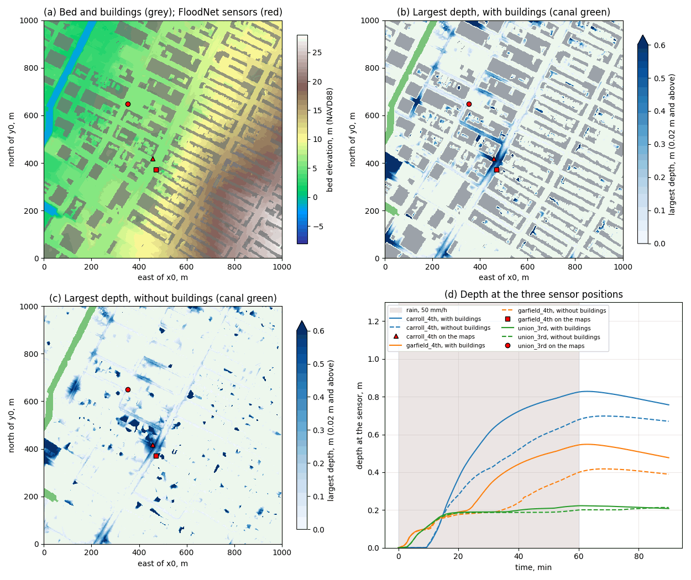

# Rain on the streets of Gowanus, Brooklyn

## Purpose

A first run of FLUME on a real place: a square of 1 km in Gowanus, Brooklyn,
New York, with its terrain and 1861 building footprints, on cells of 2 m.
The square holds 4th Avenue around Carroll Street, where a FloodNet street
sensor measured 0.91 m (35.94 in) of water on 29 September 2023, the Gowanus
Canal along its west side and the rise to Park Slope in the east.

The case shows how the pieces work together. It is not a hindcast:

- **The rain is simplified.** One rate over the whole square, 50 mm/h for
  one hour (50 mm, 50000 m3), then 30 min with no rain. It is not the rain of
  a storm.
- **No sewers, no infiltration.** All the rain runs over the surface.
- **A closed square.** Every side is a wall: no water comes in from the
  streets uphill and none leaves. Water that would leave collects at the
  west and south walls, and the canal is a closed pond.
- **One roughness.** Manning n = 0.015 on streets, yards and roofs alike.
- **Cells of 2 m, first order.** No kerbs; an alley narrower than a cell is
  closed or widened. The CFL number is the default, 0.5.

The same rain is run twice: with the buildings, and on the bare terrain.



The figure: (a) the bed and the buildings, with the three FloodNet sensors
inside the square; (b) the largest depth with the buildings; (c) without
them; (d) the depth at the three sensor positions. The canal is green in
(b) and (c).

## Files

| File | What it is |
| --- | --- |
| `prepare_gowanus.py` | Downloads the terrain and the footprints (`--download`) and writes the case: `bed.asc`, `buildings.asc`, `rain.txt`, `gowanus.inputs`, `gowanus_open.inputs` (no buildings) and `case.txt`. Needs numpy, matplotlib, Pillow and pyproj. |
| `inputs_gowanus` | The deck: 500 x 500 cells in boxes of 250 for four ranks, first order, Manning n = 0.015, walls, flood maps, a hyetograph. |
| `plot_gowanus.py` | Draws the figure and prints the numbers of the tables below. Checks that the first run is the one with the buildings and that both reached the stop time. Needs numpy and matplotlib. |

### How the case is built

- **Square.** UTM zone 18N (EPSG:26918): x from 585400 to 586400 m, y from
  4502900 to 4503900 m. FLUME runs on these coordinates.
- **Bed.** The elevation service is asked for bare earth on cells of 1 m
  (bilinear); it is averaged over 2 x 2 cells onto the flood cells, with
  20 m around the square so the bilinear reader has the whole domain. The
  canal is the lidar's water surface (bed below 0 m); it is left out of the
  depth numbers. The bed under a building is the lidar's interpolation
  between the streets around it.
- **Buildings.** A flood cell whose centre is inside a footprint is raised
  by the roof height (`flume.buildings.file`); a footprint lower than 3 m,
  or with no height, gets 3 m. The download holds 2038 footprints; 1861
  cover a cell centre of the square. 37.6 % of the square is building.
  Roofs shed their rain onto the cells beside them; 3 % of the rain stays
  in hollows between roofs of different height.
- **Gaps.** Footprints that almost touch leave slivers of a few cells that
  take roof water and have no way out. Groups of fewer than 25 open cells
  shut in by buildings are closed (546 cells). Without this the deepest cell
  was a sliver 5.1 m deep.
- **Yards.** Larger groups shut in by buildings are left open: 2.26 ha of
  yards. They take roof water in the same way and are counted in the
  tables; the Expected Results give their share.
- **Gauges.** One at each FloodNet sensor inside the square: Carroll St /
  4th Av, 4th Av / Garfield Pl, 3rd Ave / Union St.

### Why the sides are walls

The first runs had `outflow` on every side and did not keep to their rain:
after about 6 min water came in through the east and north sides, and by
20 min the square held 2e8 m3 from 2e4 m3 of rain. An outflow side copies the boundary
cell to its ghost cell, so where a street falls into the square the film of
rain flows in from the ghost cell, with nothing to limit it. Opening only
the runs of cells where the bed falls outward on both sides of the boundary
worked with the buildings (3900 m3 of the 50000 m3 left) and not without
them (98000 m3 came in through one segment). With walls both runs keep
their rain to round-off. `Docs/sphinx_doc/theory/Boundaries.rst` lists the
limits of the outflow side. Inflow on real terrain is not among them yet;
it is followed up apart from this case.

## Data and acknowledgements

Nothing is redistributed in the repository: `prepare_gowanus.py --download`
fetches the two files below (about 5 MB and 2 MB). The figure is drawn from
them.

All three were read on 28 November 2026. The first two are live services,
so a later download can differ, and the numbers below with it.

| Data | Source | Terms, as read on that day |
| --- | --- | --- |
| Terrain, bare earth, NAVD88, asked for on cells of 1 m | U.S. Geological Survey, *3D Elevation Program (3DEP)*, dynamic elevation service of The National Map, <https://elevation.nationalmap.gov/arcgis/rest/services/3DEPElevation/ImageServer> | USGS data are in the U.S. public domain |
| Building footprints and roof heights | City of New York, Office of Technology and Innovation, *Building Footprints*, NYC Open Data, <https://data.cityofnewyork.us/d/5zhs-2jue> | NYC Open Data terms of use. The catalog record names no licence, so the file is not committed |
| Sensor positions and the depth of 29 September 2023 | FloodNet (New York University, City University of New York and the City of New York; published by the Department of Environmental Protection), *FloodNet: Sensor Deployment Metadata*, <https://data.cityofnewyork.us/d/kb2e-tjy3>, and *Street Flooding Events Measured by FloodNet Sensors*, <https://data.cityofnewyork.us/d/aq7i-eu5q>, NYC Open Data | NYC Open Data terms of use. Three positions and one depth are quoted here |

Thanks to the U.S. Geological Survey for the 3DEP elevation, to the City of
New York for the open building footprints, and to the FloodNet team and the
Department of Environmental Protection for their open street-flood
measurements.

The choice of this place follows S. Annis, M. G. Badas and G. Mascaro,
*Increasing the fidelity of hyperlocal simulations of urban pluvial flooding
through street flooding observations* (University of Cagliari repository,
<https://iris.unica.it/handle/11584/471945>), who model two New York basins
against FloodNet sensors with LISFLOOD-FP. None of their files is used here.

## How to run

From an empty directory, with a stand-alone MPI build:

```bash
python3 <repo>/Tests/Gowanus/prepare_gowanus.py $PWD/data $PWD/case --download
```

```bash
mkdir with && cd with && mpiexec -n 4 <build>/flume <repo>/Tests/Gowanus/inputs_gowanus FILE=../case/gowanus.inputs && cd ..
```

```bash
mkdir without && cd without && mpiexec -n 4 <build>/flume <repo>/Tests/Gowanus/inputs_gowanus FILE=../case/gowanus_open.inputs && cd ..
```

```bash
python3 <repo>/Tests/Gowanus/plot_gowanus.py case with without gowanus.png
```

Each run takes about 50000 steps and 6 min on 4 ranks (Apple clang, macOS
arm64, Release, the two runs side by side). The generated inputs hold the
absolute paths of the case directory: run `prepare_gowanus.py` again if it
moves.

## Expected Results

From the runs of 28 November 2026 (FLUME at 185aa7a):

| Run | Steps | Rain, m3 | Stored at 5400 s, m3 | Residual, m3 |
| --- | --- | --- | --- | --- |
| With buildings | 50742 | 50000.0 | 50000.0 | -3.4e-10 |
| Without buildings | 49101 | 50000.0 | 50000.0 | -1.6e-10 |

Area by the largest depth of the run. The first two rows leave out the
canal and the cells of the building footprints, in both runs; the last two
leave out the canal only:

| Run | Area above 0.15 m, ha | above 0.3 m | above 0.5 m | above 1 m |
| --- | --- | --- | --- | --- |
| **With buildings, off the footprints** | **8.43** | **4.58** | **2.19** | **0.31** |
| Without buildings, off the footprints | 5.49 | 2.69 | 1.11 | 0.13 |
| With buildings, roofs counted | 8.72 | 4.68 | 2.21 | 0.31 |
| Without buildings, whole square | 8.51 | 4.48 | 2.10 | 0.45 |

Of the first row, 0.57, 0.31, 0.16 and 0.04 ha are in the yards shut in by
buildings; of the second, 0.32, 0.23, 0.15 and 0.03 ha are on the same
ground. On the joined streets alone the areas are 7.87, 4.27, 2.03 and
0.27 ha with the buildings and 5.17, 2.46, 0.96 and 0.10 ha without.

Peak depth at the sensor positions (time of the peak):

| Run | Carroll St / 4th Av | 4th Av / Garfield Pl | 3rd Ave / Union St |
| --- | --- | --- | --- |
| **With buildings** | **0.83 m (63 min)** | **0.55 m (63 min)** | **0.22 m (61 min)** |
| Without buildings | 0.70 m (68 min) | 0.42 m (68 min) | 0.21 m (still rising at 90 min) |

What the bed alone holds at the two sensors on 4th Avenue. Their hollow
fills to 5.83 m before it spills over the surface towards the canal:

| | Carroll St / 4th Av | 4th Av / Garfield Pl |
| --- | --- | --- |
| Depth below the spill level | 0.48 m | 0.20 m |
| Peak level, with / without buildings | 6.18 m / 6.05 m | 6.18 m / 6.05 m |
| Level at 90 min, with / without | 6.11 m / 6.02 m | 6.11 m / 6.02 m |
| Fall over the last 10 min, with / without | 3.1 / 1.7 mm/min | 3.1 / 1.7 mm/min |

What the runs show:

- The water collects on 4th Avenue between Garfield Place and Carroll
  Street, at the two FloodNet sensors there. The terrain alone picks this
  place: the run without buildings pools there too.
- The buildings move the water onto the streets. Over the whole square the
  flooded area is about the same in the two runs. Without the buildings
  32 % of the rain ends on the ground the buildings stand on; with them it
  is in the streets and yards: 0.83 m against 0.70 m at Carroll Street, and
  1.5 to 2.4 times the area above each depth off the footprints.
- The pool has two parts. The lowest 0.48 m at Carroll Street is below the
  spill level and cannot leave over the surface; in the city it leaves
  through the sewer. The 0.35 m above it at the peak is water on its way
  out, and depends on the rain rate chosen here. The pool is still 0.76 m
  deep 30 min after the rain and falling about 3 mm/min: the run is not at
  its final state.
- The canal, closed here, takes 21 % of the rain and rises 0.6 m. The real
  canal is open to the harbour.
- The deepest cell (3.1 m with the buildings, 2.9 m without) is a hollow of
  the bed inside a yard shut in by buildings, not a street. Outside the
  yards the deepest cell holds 2.9 m.

How far the numbers hold. One run each on cells of 4 m (250 x 250, first
order) gives the same pool level to 0.5 cm with the buildings and 2 cm
without, and the areas of the first row to 1 %. The depths at the sensor
positions change by up to 0.1 m (Garfield 0.55 to 0.44 m, Union 0.22 to
0.13 m), because the bed of the cell the sensor falls in changes. A
second-order run on 4 m gives the same peak level and a pool 8 cm higher
at 20 min. No finer grid was run: the point depths are not shown to be
converged.

For scale only: the sensor at Carroll Street measured 0.91 m on
29 September 2023, and this run gives 0.83 m there. The two numbers are
not comparable and their nearness is not evidence of agreement. The rain
here is not that storm's, there is no sewer, the square is closed, and the
depth at a point changes by tenths of a metre with the bed of its cell.

## CTest

None. The case needs the two downloads. A CTest would need a small synthetic
copy of the rasters or data that may be committed.
